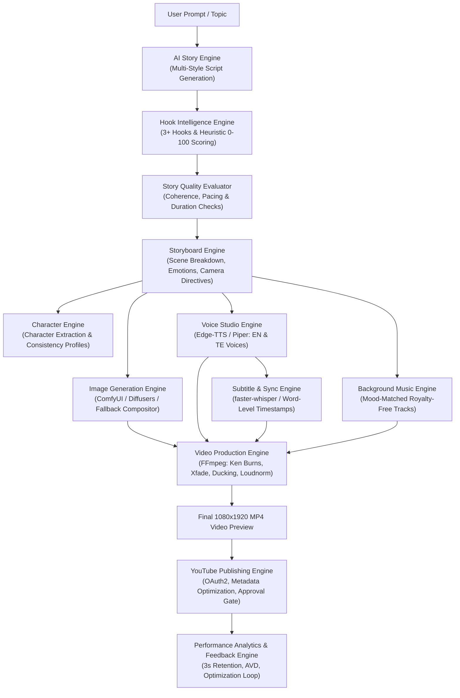
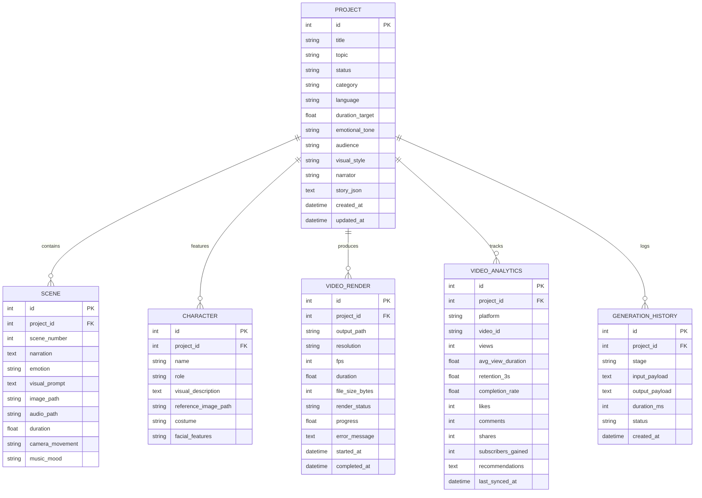

# StoryForge AI — System Architecture & Technical Specification

## 1. System Overview

**StoryForge AI** is a production-grade, modular content creation platform that automates the transformation of a simple text prompt into a viral vertical video (1080×1920, 9:16) for YouTube Shorts, Instagram Reels, and TikTok.

### End-to-End Workflow



---

## 2. Directory Structure

```
storyforge/
├── assets/
│   ├── characters/           # Character reference sheets & images
│   ├── audio/                # Voiceovers & sound effects
│   ├── music/                # Royalty-free music library categorized by mood
│   └── fonts/                # Fonts with Telugu Unicode support (Nirmala UI / Noto Sans)
├── backend/
│   ├── app/
│   │   ├── api/              # FastAPI endpoints & WebSocket routes
│   │   │   ├── routes/       # projects, stories, scenes, images, audio, renders, youtube, analytics
│   │   │   └── websockets/   # real-time progress broadcast
│   │   ├── core/             # Configuration, logging, events
│   │   ├── database/         # SQLite async engine, session factory, base metadata
│   │   ├── models/           # SQLAlchemy ORM models
│   │   ├── schemas/          # Pydantic v2 schemas
│   │   ├── services/         # Modular domain services
│   │   │   ├── story_engine/
│   │   │   ├── hook_engine/
│   │   │   ├── storyboard_engine/
│   │   │   ├── character_engine/
│   │   │   ├── image_engine/
│   │   │   ├── voice_engine/
│   │   │   ├── subtitle_engine/
│   │   │   ├── music_engine/
│   │   │   ├── video_engine/
│   │   │   ├── analytics_engine/
│   │   │   └── youtube_engine/
│   │   ├── storage/          # Local file storage handlers
│   │   └── workers/          # Background task queue & job executors
│   ├── tests/                # Automated unit and integration tests
│   └── requirements.txt
├── frontend/
│   ├── src/
│   │   ├── components/       # UI components (Header, Sidebar, Player, Cards)
│   │   ├── pages/            # Dashboard, CreateStory, StoryEditor, Storyboard, VoiceStudio, VideoEditor, Analytics, Settings
│   │   ├── services/         # Axios/Fetch API client & WebSocket client
│   │   └── types/            # TypeScript interfaces
│   ├── package.json
│   └── tailwind.config.js
├── outputs/
│   ├── projects/             # Project state dumps
│   ├── videos/               # Final rendered MP4 files
│   ├── subtitles/            # Synchronized SRT & ASS files
│   └── thumbnails/           # Auto-generated YouTube thumbnails
├── RESEARCH.md
├── ARCHITECTURE.md
├── TESTING.md
└── README.md
```

---

## 3. Database Schema

The persistence layer uses SQLite with SQLAlchemy AsyncSession.



---

## 4. Subtitle & Multi-Language Specification (English & Telugu)

Subtitles use Advanced SubStation Alpha (`.ass`) or FFmpeg `drawtext` with:
- **Font:** `Nirmala UI` or `Noto Sans Telugu` with complete Unicode glyph support.
- **Dynamic Word Highlighting:** As each word is spoken, its color shifts from muted white (`#FFFFFF`) to vibrant amber-gold (`#FFD700`) with a dark outline (`#000000`).
- **Safe Margins:** Vertical placement is fixed at 75% height to avoid covering TikTok/Shorts UI buttons (likes, profile, share).

---

## 5. Video Composition Engine (FFmpeg Pipeline)

Each scene is composited using a robust FFmpeg filtergraph:
1. **Dynamic Ken Burns:**
   - Zoom in: `zoompan=z='min(zoom+0.0015,1.25)':d=duration*fps:x='iw/2-(iw/zoom/2)':y='ih/2-(ih/zoom/2)':s=1080x1920:fps=30`
   - Pan left-to-right or right-to-left based on scene camera metadata.
2. **Audio Mixing & Ducking:**
   - Background music track is looped and attenuated by 18dB whenever speech audio is active using `sidechaincompress` or dynamic volume envelopes.
3. **Audio Normalization:**
   - Master audio is normalized to EBU R128 (-14 LUFS for YouTube Shorts).
