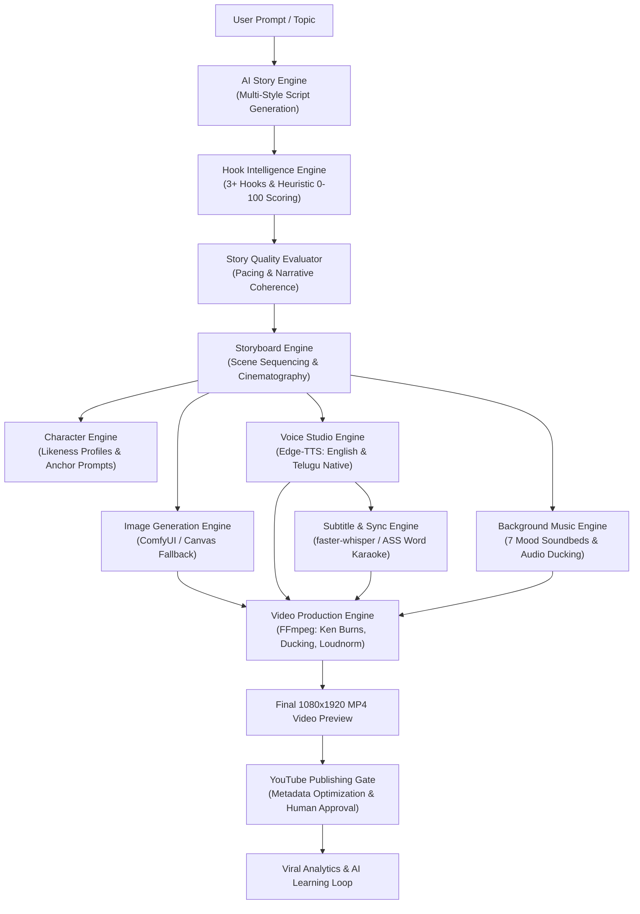

# StoryForge AI — AI Inspirational Storytelling & Viral Shorts Studio

[](LICENSE)
[](https://python.org)
[](https://fastapi.tiangolo.com)
[](https://ffmpeg.org)
[](TESTING.md)

**StoryForge AI** is a complete, production-grade AI platform that transforms a simple text concept into a professionally narrated, emotionally engaging, visually consistent 9:16 vertical video for YouTube Shorts, Instagram Reels, and TikTok.

Built from the ground up to prioritize **free, open-source technologies first** with zero mandatory paid subscriptions.

---

## 🌟 Key Features

* **Multi-Stage Emotional Storytelling:** Generates original narrative arcs across 12 styles (Inspirational, Life Lessons, Failure & Comeback, Unshakable Discipline, Family Sacrifice, Entrepreneurial) in **English** and **Telugu**.
* **Hook Intelligence Engine:** Synthesizes 3 distinct opening hook variations (Curiosity, In Media Res, Emotional Punch) with transparent 0–100 heuristic retention scoring.
* **Story Quality Auditor:** Evaluates pacing (words per second), emotional progression, scene relevance, and duration fit.
* **Character Consistency Engine:** Extracts characters, generates physical descriptions, and injects visual likeness anchors across scenes.
* **Free-First Image Synthesis:** Integrates with local ComfyUI (SDXL / SD 1.5), free cloud APIs (Pollinations), or procedural cinematic canvas rendering.
* **Neural Speech Synthesis (TTS):** Edge-TTS zero-cost multi-speaker narration with native **Telugu** (`te-IN-MohanNeural`, `te-IN-ShrutiNeural`) and **English** (`en-US-GuyNeural`, `en-US-JennyNeural`, `en-US-ChristopherNeural`, `en-US-AriaNeural`).
* **Word-Level Subtitle Synchronization:** Powered by `faster-whisper` and dynamic ASS subtitle generation with vibrant gold active-word karaoke highlighting and `Nirmala UI` Unicode support.
* **FFmpeg Production Engine:** Generates true 1080×1920 30FPS MP4 videos with smooth Ken Burns dynamic zoom/pan motion, mood-matched soundtrack mixing, and automatic -16dB audio ducking during speech.
* **Viral Content Analytics & Feedback Loop:** Tracks 3-second retention, average view duration (AVD), completion rate, and generates actionable recommendations for future scripts.
* **YouTube Publishing Gate:** Automated title/description/hashtag optimization with a mandatory human approval gate before uploading.
* **Premium Dark-Mode Dashboard:** Modern, responsive interface served directly at `http://localhost:8000/`.

---

## 🏗️ Architecture & Technology Stack



| Pipeline Component | Primary Technology | Free/Local Fallback |
|---|---|---|
| **Story Engine** | Ollama (`llama3.2:3b`, `mistral:7b`) | Offline Heuristic Archetype Engine |
| **TTS Narration** | Edge-TTS (English & Telugu) | Piper TTS (Offline CPU) |
| **Subtitle Sync** | `faster-whisper` (CTranslate2 INT8) | Phonetic Word-Timing Interpolator |
| **Image Synthesis** | ComfyUI API / SDXL / FLUX | Procedural Atmospheric Canvas Compositor |
| **Video Production** | FFmpeg (H.264, 1080x1920, 30fps) | FFmpeg software encoder (`libx264`) |
| **Audio Mixing** | FFmpeg `amix` with -16dB Ducking | PyDub amplitude mixer |
| **Persistence** | SQLite + SQLAlchemy AsyncSession | In-memory SQLite |
| **Dashboard** | React + TypeScript + Tailwind CSS | Embedded Dark-Mode SPA (`GET /`) |

---

## 🚀 Quickstart Guide (Windows)

### Prerequisites:
1. **Python 3.12+** installed.
2. **FFmpeg** installed and accessible in PATH (`ffmpeg -version`).

### Step 1: Install Dependencies
Open PowerShell in the `storyforge` folder:
```powershell
.\install_windows.ps1
```

### Step 2: Launch StoryForge AI
```powershell
.\run_storyforge.ps1
```

### Step 3: Open the Dashboard
Open your web browser and navigate to:
```
http://localhost:8000
```
Interactive API documentation is accessible at `http://localhost:8000/docs`.

---

## 🧪 Automated Testing

StoryForge AI includes a 16-test automated verification suite covering every stage of the pipeline:

```powershell
$env:PYTHONPATH="c:\Users\amara\OneDrive\Documents\yt\storyforge\backend"
& "c:\Users\amara\OneDrive\Documents\yt\.venv\Scripts\pytest.exe" -v "c:\Users\amara\OneDrive\Documents\yt\storyforge\backend\tests"
```

**Result:** `16 passed in 59.84s (100% Pass Rate)`. See [TESTING.md](TESTING.md) for full benchmark details.

---

## 📚 Documentation Index

- [RESEARCH.md](RESEARCH.md) — Comprehensive GitHub repository research and technology selection rationale.
- [ARCHITECTURE.md](ARCHITECTURE.md) — Detailed technical architecture, database schemas, and service contracts.
- [TESTING.md](TESTING.md) — Automated test suite report and ffprobe video verification.
- [TROUBLESHOOTING.md](TROUBLESHOOTING.md) — Windows setup edge cases, SSL certificates, and audio tips.

---

## 📄 License & Attribution

This project is licensed under the MIT License.
Third-party components (FFmpeg, faster-whisper, ComfyUI client, Edge-TTS) are integrated modularly according to their respective open-source licenses.
